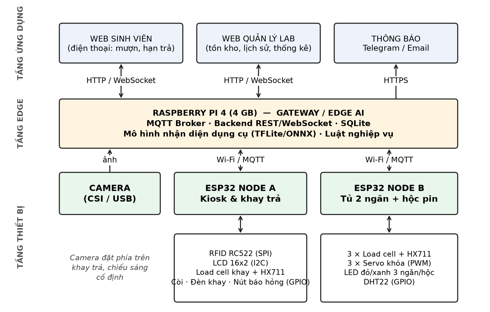
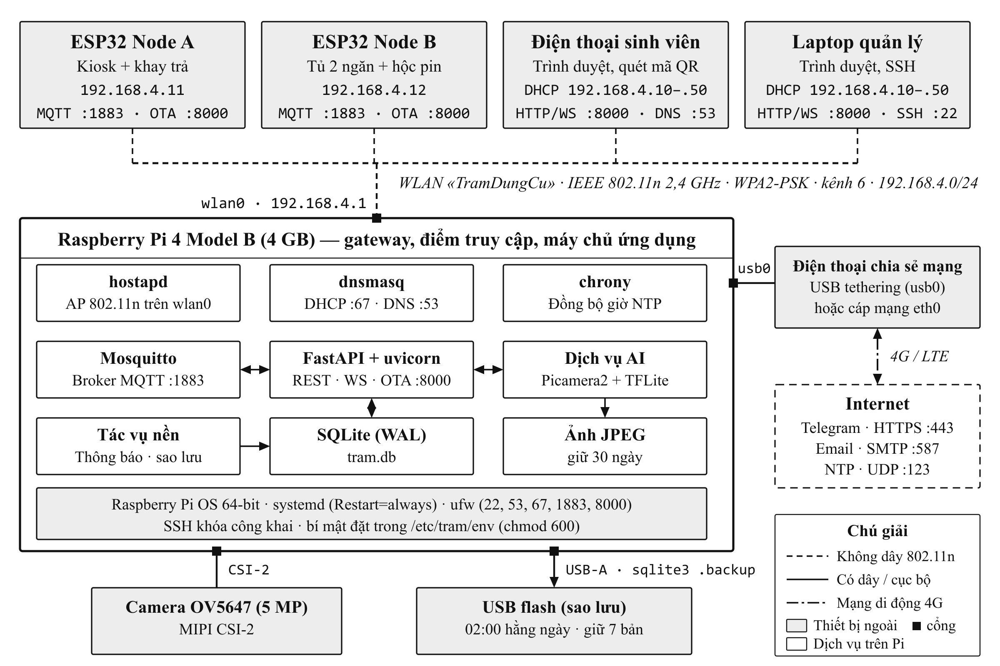
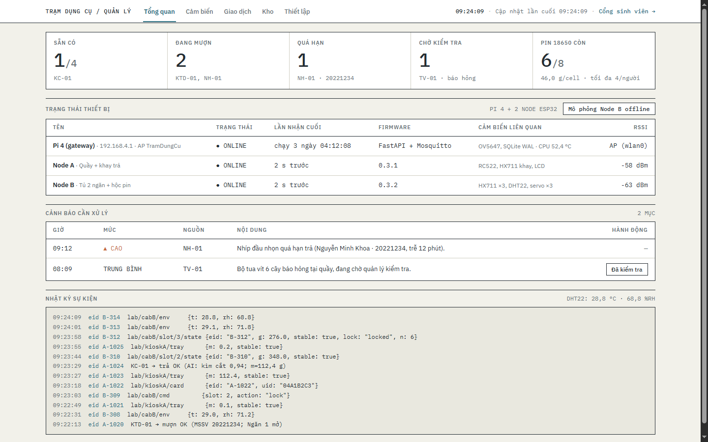
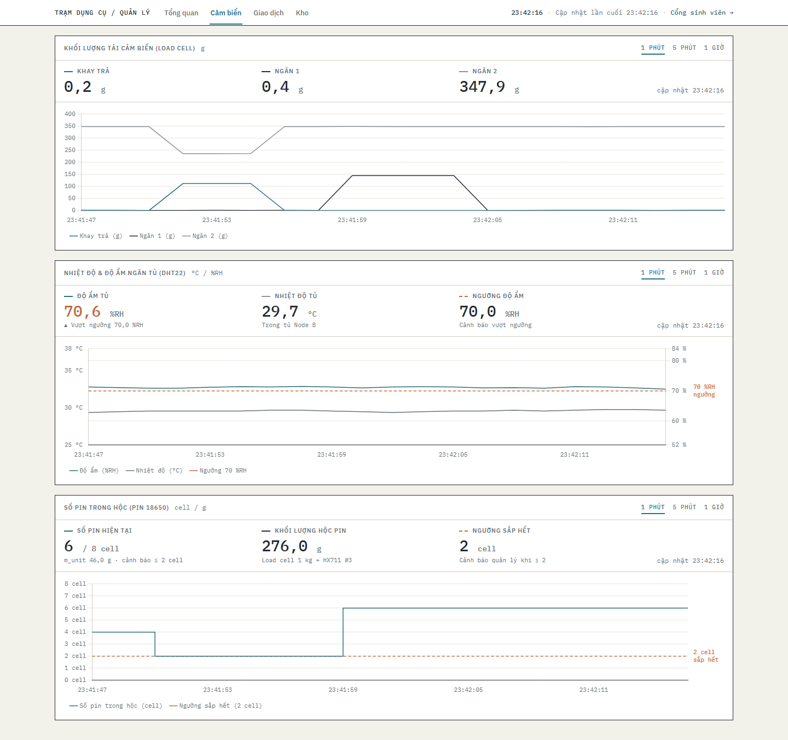
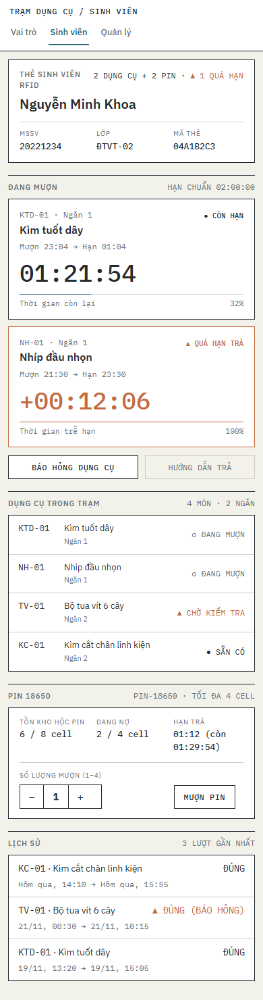

# Smart Tool Station

**Trạm mượn – trả dụng cụ thông minh ứng dụng Edge AI** cho phòng thực hành.
Đồ án nhóm 5 người, môn *Kiến trúc và giao thức IoT* (lý thuyết + thực tập).

> **Trạng thái:** giai đoạn thiết kế. Báo cáo, danh sách linh kiện, kế hoạch phân công, đặc tả MQTT và giao diện web mẫu (dữ liệu giả) đã xong. Mã firmware, backend và mô hình AI chưa viết (các thư mục tương ứng mới có README khung). Mọi con số hiệu năng, độ trễ, công suất và giá trong tài liệu là **mục tiêu hoặc ước tính, chưa đo**.

## Hệ thống làm gì

Sinh viên quẹt thẻ RFID rồi chọn vật phẩm trên web:

- **Dụng cụ cầm tay không dùng điện** (kìm cắt, kìm tuốt dây, bộ tua vít, nhíp), đặt trong 2 ngăn có khóa.
- **Pin 18650 có mạch bảo vệ**, cho mượn theo số lượng (tối đa 4 cell mỗi người), đặt trong một hộc riêng.

Khi trả, vật phẩm đặt lên khay có camera. Hệ thống kiểm tra đồng thời hai điều kiện rồi mới mở ngăn:

1. **Đúng loại**: camera + mô hình TFLite INT8 (6 lớp) chạy ngay trên Raspberry Pi 4; ảnh không rời mạng nội bộ.
2. **Đủ số lượng, đủ phụ kiện**: load cell cân khối lượng. Với pin, số cell = khối lượng ÷ 46 g, dung sai `2 g + 1,5 g × n`.

Dụng cụ có vấn đề thì người trả bấm nút báo hỏng: dụng cụ bị khóa chờ người quản lý kiểm tra và Telegram báo ngay.



## Phần cứng

| Khối | Linh kiện chính | Vai trò |
|---|---|---|
| Gateway / Edge AI | Raspberry Pi 4 (4 GB), camera OV5647 | Mosquitto, FastAPI + SQLite, suy luận AI, phục vụ web, Telegram/Email |
| Node A – kiosk + khay trả | ESP32, RC522, LCD 16×2 I2C, 1 load cell + HX711, còi, đèn khay, nút báo hỏng | Quẹt thẻ, cân vật phẩm trả, hiển thị, báo hỏng |
| Node B – 2 ngăn dụng cụ + hộc pin | ESP32, 3 load cell + HX711, 3 servo SG90, LED đỏ/xanh, DHT22 | Cân từng ngăn và hộc (đếm pin), khóa/mở, đo nhiệt độ – độ ẩm trong tủ |

Chi phí linh kiện cần mua thêm khoảng **1,18 triệu đồng** (đã trừ Raspberry Pi 4, hai ESP32 và một số món nhóm có sẵn; giá ước tính, xem [danh sách linh kiện](docs/DanhSachLinhKien.xlsx)). Mạch hàn trên PCB đục lỗ, vẽ sơ đồ nguyên lý bằng KiCad.

## Mạng và triển khai



- Raspberry Pi 4 tự phát Wi-Fi `TramDungCu` (2,4 GHz, WPA2-PSK, `192.168.4.1`), nên không phụ thuộc Wi-Fi của trường. Internet cho Telegram, Email và NTP lấy qua điện thoại chia sẻ mạng bằng USB.
- ESP32 và Pi giao tiếp bằng **MQTT 3.1.1** (QoS 1, retained, Last Will, loại trùng bằng `eid`/`cid`). Chi tiết ở [docs/mqtt_spec.md](docs/mqtt_spec.md).
- Web do FastAPI trên Pi phục vụ ở cổng 8000: `http://tram.local:8000` hoặc `http://192.168.4.1:8000`. Dữ liệu lưu cục bộ trong SQLite (`/var/lib/tram/tram.db`), sao lưu hằng ngày ra USB.
- Cấu hình mẫu cho Pi (hostapd, dnsmasq, Mosquitto, systemd, sao lưu) nằm trong [pi/backend/config/](pi/backend/config/README.md). **Đây là bản mẫu, chưa chạy thử trên Pi thật.**

## Giao diện web mẫu

Thư mục [web-ui/](web-ui/README.md) là bản giao diện tĩnh (HTML, CSS, JavaScript thuần, dữ liệu giả lập) cho sinh viên và người quản lý. Mở file `web-ui/index.html` bằng trình duyệt là chạy, cần Internet để tải font và thư viện biểu đồ.

<p>
  
  
</p>
<p>
  
</p>

## Cấu trúc thư mục

```
docs/             Báo cáo (docx, pdf), danh sách linh kiện, phân công, đặc tả MQTT, ảnh
firmware/node_a   Firmware ESP32 Node A (khung)
firmware/node_b   Firmware ESP32 Node B (khung)
pi/backend        Backend FastAPI, CSDL SQLite, cấu hình mẫu cho Pi (config/)
pi/ai             Thu thập ảnh, huấn luyện, mô hình TFLite, dịch vụ suy luận (khung)
hardware/kicad    Sơ đồ nguyên lý và bố trí mạch (khung)
web-ui/           Giao diện web mẫu
tools/            Script sinh lại báo cáo, sơ đồ và file Excel
```

## Tài liệu

| Tài liệu | Nội dung |
|---|---|
| [Báo cáo (PDF)](docs/BaoCaoYTuong.pdf) | Khảo sát, chức năng, sơ đồ khối và nguyên lý, luồng hoạt động, hạ tầng, kiểm thử, chi phí, kế hoạch |
| [Danh sách linh kiện](docs/DanhSachLinhKien.xlsx) | Nhập số lượng đã có, file tự tính số tiền cần mua |
| [Phân công nhiệm vụ](docs/PhanCongNhiemVu.xlsx) | 49 việc cho 5 thành viên trong 6 tuần, có cột trạng thái |
| [Đặc tả MQTT](docs/mqtt_spec.md) | Topic, payload, QoS, phân quyền, OTA |
| [Nghiên cứu giao diện](docs/ui_research.md) | So sánh các template và hướng thiết kế đã xét |

Nguồn ảnh linh kiện trong báo cáo ghi ở [docs/images/parts/SOURCES.md](docs/images/parts/SOURCES.md).

## Phân công

| Thành viên | Mảng |
|---|---|
| TV1 (nhóm trưởng) | Tích hợp hệ thống, đặc tả MQTT, kiểm thử, sao lưu, báo cáo |
| TV2 | Node A: KiCad, hàn mạch, firmware ESP32-A, OTA |
| TV3 | Node B: KiCad, hàn mạch, firmware ESP32-B, cơ khí, hộc pin |
| TV4 | Edge AI: camera, dữ liệu ảnh, mô hình, suy luận; thử mạng trên điện thoại |
| TV5 | Backend, CSDL, web, đăng nhập, Telegram/Email |

## Sinh lại tài liệu

Báo cáo, sơ đồ và file Excel đều sinh từ script trong `tools/`. Muốn đổi linh kiện thì sửa `tools/parts.json`, muốn đổi nội dung báo cáo thì sửa `tools/build_report.js`.

```bash
cd tools
npm install                  # thư viện docx cho Node.js
pip install matplotlib openpyxl pillow
python diagram2.py && python diagram3.py && python seq.py   # sơ đồ (matplotlib) -> docs/images
python figures/so_do_mang.py # sơ đồ mạng: sinh SVG rồi xuất PNG/PDF bằng Inkscape (sửa đường dẫn INKSCAPE trong file)
python xlsx_parts.py         # docs/DanhSachLinhKien.xlsx
python tasks.py              # docs/PhanCongNhiemVu.xlsx (GHI ĐÈ cột trạng thái)
node build_report.js         # docs/BaoCaoYTuong.docx
```

File PDF được xuất bằng Microsoft Word (Save As → PDF).

## Tiến độ

- [x] Báo cáo, danh sách linh kiện, phân công, đặc tả MQTT, giao diện mẫu
- [ ] Tuần 1: đặt mua linh kiện, cài Pi và mạng Wi-Fi riêng, sơ đồ nguyên lý KiCad
- [ ] Tuần 2: hàn mạch, firmware cơ bản, cơ khí
- [ ] Tuần 3: cân, servo, dữ liệu ảnh, huấn luyện, backend
- [ ] Tuần 4: MQTT trên node, dịch vụ AI, ghép đầu – cuối
- [ ] Tuần 5: kiểm thử và đo đạc (độ chính xác cân, AI, độ trễ, công suất)
- [ ] Tuần 6: báo cáo cuối, video demo

## Giấy phép

Chưa chọn giấy phép; mặc định bảo lưu mọi quyền. Ảnh linh kiện lấy từ nguồn bên ngoài (Wikimedia Commons, Adafruit) chỉ dùng minh họa trong báo cáo và nên thay bằng ảnh tự chụp trước khi công khai.
